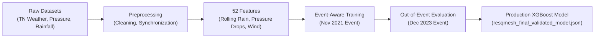

# ResQMesh XGBoost Dataset Repository

[](https://xgboost.readthedocs.io/)
[](https://github.com/vijayakrishan/XG-BOOST---DATASET)
[](#)
[](#)

---

## 1. Purpose

The **ResQMesh XGBoost Dataset Repository** hosts the complete, reproducible dataset collections, feature-engineering pipelines, exploratory notebooks, and trained Gradient Boosted Decision Tree (XGBoost) model artifacts for the **ResQMesh Emergency Network & Decision Support System**.

### Operational Context for Reviewers:
**ResQMesh** is an off-grid, hardware-deployable LoRa mesh communication network designed for humanitarian disaster response when cellular backhauls collapse. Operating in tandem with the hardware network (Victim Nodes, Relay Nodes, and Command Base Stations), the **AI Module** serves as an environmental disaster risk estimation and decision-support engine. 

By analyzing multi-station telemetry (atmospheric pressure drops, multi-hour cumulative rainfall, river gauge metrics, and regional climate records), the XGBoost risk model estimates current flood and disaster risk regimes to prioritize LoRa mesh emergency routing and dispatch rescue teams effectively.

---

## 2. Repository Architecture & Quick Navigation

For an SIH reviewer or researcher seeking immediate answers:

| Question | Directory | Description |
|---|---|---|
| **WHERE IS THE RAW DATA?** | [`datasets/raw/`](datasets/raw/) | Original, unmodified sensor telemetry, weather archives, and terrain datasets. |
| **WHERE IS THE PROCESSED DATA?** | [`datasets/processed/`](datasets/processed/) | Cleaned, feature-engineered, and event-partitioned train/test datasets. |
| **WHERE ARE THE EXTERNAL DATASETS?** | [`datasets/external/`](datasets/external/) | External benchmarks (Kaggle, IMD, Government Climate Archives). |
| **WHERE ARE THE NOTEBOOKS?** | [`notebooks/`](notebooks/) | Fully executed EDA and model benchmarking notebook (`flood-prediction-model.ipynb`). |
| **WHERE IS THE PREPROCESSING & TRAINING WORK?** | [`preprocessing/`](preprocessing/) | Standalone training script (`train_model.py`) and 18 modular pipeline scripts. |
| **WHERE IS THE TRAINED MODEL?** | [`models/`](models/) | Production XGBoost model (`resqmesh_final_validated_model.json`), schemas, and thresholds. |
| **WHERE IS THE DOCUMENTATION & REPORTS?** | [`documentation/`](documentation/) | Scientific evaluation reports, metrics JSON, feature importance, and confusion matrix. |

### Directory Tree:
```text
XG-BOOST---DATASET/
├── README.md                                  # Main repository documentation & guide
├── .gitignore                                 # Git configuration excluding caches/large files
│
├── datasets/
│   ├── raw/                                   # Original unaltered sensor & telemetry datasets
│   │   ├── README.md                          # Inventory and schema documentation
│   │   ├── flood.csv                          # Uncompressed 50K-row tabular flood factor benchmark
│   │   ├── archive (5).zip                    # TNweather_1.8M.csv (1.88M hourly records across 37 districts)
│   │   ├── archive (6).zip                    # Terrain sensor dataset (accelerometer, gyro, vibration, images)
│   │   ├── pressure_tel_hr_tamil-nadu-sw-gw_tn_2021_2021.csv
│   │   ├── pressure_tel_hr_tamil-nadu-sw-gw_tn_2022_2022.csv
│   │   ├── pressure_tel_hr_tamil-nadu-sw-gw_tn_2023_2023.csv
│   │   ├── pressure_tel_hr_tamil_nadu_sw_gw_tn_2026_2030.csv
│   │   ├── rainfall_tel_hr_tamil_nadu_sw_gw_tn_2026_2030.csv
│   │   ├── wind_speed_manual_twicedaily_tamil_nadu_sw_gw_tn_1970_2025.csv
│   │   └── wind_speed_manual_twicedaily_tamil_nadu_sw_gw_tn_2026_2030.csv
│   │
│   ├── processed/                             # Cleaned, standardized & partitioned datasets
│   │   ├── README.md                          # Methodology & feature documentation
│   │   ├── train_event_aware.csv              # Development partition (Nov 2021 flood, 10,944 samples)
│   │   ├── test_event_aware.csv               # Unseen evaluation partition (Dec 2023 flood, 1,152 samples)
│   │   ├── event_aware_train.csv              # Standardized temporal feature train split
│   │   ├── event_aware_test.csv               # Standardized temporal feature test split
│   │   ├── environmental_combined.csv         # Multi-sensor fusion matrix (rain, pressure, river)
│   │   ├── flood_weather_matched.csv          # Telemetry aligned with verified flood events
│   │   ├── tamil_nadu_flood_events.csv        # Disaster catalog across Tamil Nadu districts
│   │   ├── tamil_nadu_district_rainfall_normals.csv # IMD district monthly rainfall normals
│   │   ├── tamil_nadu_historical_rainfall_summary.csv # Long-term rainfall baseline statistics
│   │   ├── water_level_labeled.csv            # River gauge warning threshold classifications
│   │   ├── xgboost_train.csv                  # Tabular matrix ready for XGBoost training
│   │   ├── xgboost_test.csv                   # Tabular matrix for out-of-sample testing
│   │   ├── feature_group_comparison.csv       # Feature ablation experimental comparisons
│   │   ├── resqmesh_final_validation_results.csv # Threshold-by-threshold validation metrics
│   │   └── resqmesh_final_unseen_test_results.csv# Performance metrics on unseen 2023 disaster event
│   │
│   └── external/                              # Downloaded & external reference datasets
│       ├── README.md                          # Registry & large asset advisory (archive (2).zip)
│       ├── archive.zip                        # Kaggle s4e5 Flood Prediction Challenge dataset
│       ├── flood.csv(1).zip                   # Original archive of 20 flood risk factors
│       ├── archive (1).zip                    # Indian Climate Dataset 2024-2025
│       ├── archive (4).zip                    # Indian Climate Dataset 2024-2025 (secondary copy)
│       ├── archive (3).zip                    # Flood Risk Dataset India (14 attributes)
│       ├── archive (7).zip                    # Flood Risk Dataset India (secondary copy)
│       ├── archive (8).zip                    # Combined Government Climate Archives bundle
│       ├── archive (9).zip                    # Nepal Flood & Weather Dataset (2023-2026)
│       ├── archive (10).zip                   # IMD Rainfall in India (1901-2015) & District Normals
│       └── archive (11).zip                   # Government Climate Datasets Directory Index
│
├── notebooks/                                 # Jupyter development notebooks
│   ├── README.md                              # Notebook overview & reproduction guide
│   └── flood-prediction-model.ipynb           # EDA, Decision Tree, Random Forest & XGBoost modeling
│
├── preprocessing/                             # End-to-end and modular pipeline scripts
│   ├── README.md                              # Script index & pipeline execution guide
│   ├── train_model.py                         # Single-command reproducible training entry point
│   ├── 01_inspect_all.py                      # Telemetry source audit
│   ├── 02_quality_check.py                    # Missing value & outlier diagnostics
│   ├── 03_clean_environment.py                # Telemetry synchronization & cleaning
│   ├── 04_prepare_water_level.py              # River gauge warning feature extractor
│   ├── 05_combine_environmental_data.py       # Multi-sensor fusion engine
│   ├── 06_prepare_rainfall_features.py        # Precipitation accumulation calculator
│   ├── 17_prepare_xgboost_data.py             # Feature matrix scaling and formatting
│   ├── 18_train_xgboost.py                    # Baseline XGBoost training
│   ├── 19_evaluate_xgboost.py                 # Evaluation & confusion matrix generation
│   ├── 24_prepare_event_training_data.py      # Event-based labeling for Nov 2021 event
│   ├── 25_create_event_aware_split.py         # Chronological event separation
│   ├── 26_train_event_xgboost.py              # Event-aware GBDT training
│   ├── 35_prepare_final_training_data.py      # Feature selection & matrix compilation
│   ├── 36_create_event_aware_split.py         # 2023 out-of-event partition isolation
│   ├── 37_train_improved_xgboost.py           # Regularized tree parameter tuning
│   ├── 44_create_temporal_weather_features.py # 52 multi-scale rolling lag feature generator
│   ├── 45_train_temporal_xgboost.py           # Temporal lag XGBoost model trainer
│   └── 50_final_validation.py                 # Out-of-event evaluation on Dec 2023 test set
│
├── models/                                    # Serialized model artifacts & schemas
│   ├── README.md                              # Model architecture, hyperparameters & thresholds
│   ├── resqmesh_final_validated_model.json    # Production XGBoost Model (700 trees, JSON format)
│   ├── resqmesh_final_validated_features.json # Ordered list of 52 model input features
│   ├── resqmesh_final_validated_threshold.json# Calibrated decision thresholds (Low, Mod, High, Ext)
│   ├── resqmesh_improved_event_xgboost.json   # Intermediate event-aware baseline model
│   ├── resqmesh_physical_xgboost.json         # Physical-features-only ablation model
│   ├── resqmesh_no_calendar_xgboost.json      # Non-calendar temporal model
│   ├── resqmesh_xgboost_model.json            # Baseline GBDT model
│   ├── resqmesh_xgboost_features.joblib       # Pickled feature order schema
│   └── xgboost_evaluation.txt                 # Model validation log
│
└── documentation/                             # Formal evaluation reports & metrics
    ├── README.md                              # Documentation index
    ├── final_training_report.md               # Scientific evaluation report (Event-Aware protocol)
    ├── final_metrics.json                     # JSON-formatted test metrics (Accuracy, ROC-AUC, PR-AUC)
    ├── confusion_matrix.csv                   # Confusion matrix on unseen 2023 test event
    └── feature_importance.csv                 # Feature importance ranking for all 52 features
```

---

## 3. Dataset Master Table

| Dataset | Type | Format | Primary Purpose in ResQMesh | Repository Location |
|---|---|---|---|---|
| **TN Weather Comprehensive** | Raw | ZIP (`.csv`) | Historical hourly meteorology (1.88M rows across 37 districts) for temporal lag feature extraction | [`datasets/raw/archive (5).zip`](datasets/raw/archive%20(5).zip) |
| **Tamil Nadu Pressure Telemetry 2021** | Raw | CSV | Ground-truth barometric pressure telemetry during the statewide Nov 2021 flood event | [`datasets/raw/pressure_tel_hr_tamil-nadu-sw-gw_tn_2021_2021.csv`](datasets/raw/pressure_tel_hr_tamil-nadu-sw-gw_tn_2021_2021.csv) |
| **Tamil Nadu Pressure Telemetry 2022** | Raw | CSV | Full-year continuous atmospheric pressure telemetry for baseline distribution modeling | [`datasets/raw/pressure_tel_hr_tamil-nadu-sw-gw_tn_2022_2022.csv`](datasets/raw/pressure_tel_hr_tamil-nadu-sw-gw_tn_2022_2022.csv) |
| **Tamil Nadu Pressure Telemetry 2023** | Raw | CSV | Telemetry capturing the catastrophic December 2023 Southern TN extreme event | [`datasets/raw/pressure_tel_hr_tamil-nadu-sw-gw_tn_2023_2023.csv`](datasets/raw/pressure_tel_hr_tamil-nadu-sw-gw_tn_2023_2023.csv) |
| **Tamil Nadu Pressure Stream 2026–2030** | Raw | CSV | Telemetry station sensor stream schema and future projection templates | [`datasets/raw/pressure_tel_hr_tamil_nadu_sw_gw_tn_2026_2030.csv`](datasets/raw/pressure_tel_hr_tamil_nadu_sw_gw_tn_2026_2030.csv) |
| **Tamil Nadu Rainfall Telemetry 2026–2030** | Raw | CSV | Multi-station hourly telemetry precipitation observations | [`datasets/raw/rainfall_tel_hr_tamil_nadu_sw_gw_tn_2026_2030.csv`](datasets/raw/rainfall_tel_hr_tamil_nadu_sw_gw_tn_2026_2030.csv) |
| **Tamil Nadu Wind Speed Series 1970–2025** | Raw | CSV | 55-year longitudinal surface wind speed monitoring for cyclone & depression correlation | [`datasets/raw/wind_speed_manual_twicedaily_tamil_nadu_sw_gw_tn_1970_2025.csv`](datasets/raw/wind_speed_manual_twicedaily_tamil_nadu_sw_gw_tn_1970_2025.csv) |
| **Terrain Sensor Dataset** | Raw | ZIP (`.csv` + images) | Tri-axial accelerometer, gyroscope, vibration, and multi-class disaster terrain classification | [`datasets/raw/archive (6).zip`](datasets/raw/archive%20(6).zip) |
| **Flood Benchmark Factor Dataset** | Raw / Benchmark | CSV | 50,000 observations of 20 environmental flood factors directly runnable in notebook | [`datasets/raw/flood.csv`](datasets/raw/flood.csv) |
| **Event-Aware Training Split** | Processed | CSV | Training partition isolated to the Nov 2021 event (10,944 samples: 2,736 flood, 8,208 normal) | [`datasets/processed/train_event_aware.csv`](datasets/processed/train_event_aware.csv) |
| **Unseen Out-of-Event Test Split** | Processed | CSV | Evaluation partition strictly isolated to the Dec 2023 event (1,152 samples: 288 flood, 864 normal) | [`datasets/processed/test_event_aware.csv`](datasets/processed/test_event_aware.csv) |
| **Multi-Sensor Environmental Fusion** | Processed | CSV | Merged hourly environmental observations (precipitation, temperature, barometric pressure) | [`datasets/processed/environmental_combined.csv`](datasets/processed/environmental_combined.csv) |
| **Tamil Nadu Flood Event Catalog** | Processed | CSV | Georeferenced disaster event boundaries and ground-truth validation records | [`datasets/processed/tamil_nadu_flood_events.csv`](datasets/processed/tamil_nadu_flood_events.csv) |
| **IMD District Rainfall Normals** | Processed | CSV | Long-term monthly baseline normals for all 37 districts to calculate precipitation anomalies | [`datasets/processed/tamil_nadu_district_rainfall_normals.csv`](datasets/processed/tamil_nadu_district_rainfall_normals.csv) |
| **XGBoost Final Train/Test Matrices** | Processed | CSV | Feature-engineered tabular inputs with 52 physical/temporal variables for GBDT training | [`datasets/processed/xgboost_train.csv`](datasets/processed/xgboost_train.csv) |
| **Kaggle Flood Prediction Challenge** | External | ZIP (`.csv`) | Multi-split benchmark dataset (1.11M rows) used for cross-regional model validation | [`datasets/external/archive.zip`](datasets/external/archive.zip) |
| **India National Flood Risk Dataset** | External | ZIP (`.csv`) | Georeferenced river discharge, elevation, soil type, and flood occurrence points | [`datasets/external/archive (3).zip`](datasets/external/archive%20(3).zip) |
| **Indian Climate Dataset (2024–2025)** | External | ZIP (`.csv`) | Daily weather, AQI, and atmospheric pressure across major Indian metropolitan cities | [`datasets/external/archive (1).zip`](datasets/external/archive%20(1).zip) |
| **Nepal River Basin Flood & Weather** | External | ZIP (`.csv`) | High-altitude Himalayan catchment river discharge and weather telemetry | [`datasets/external/archive (9).zip`](datasets/external/archive%20(9).zip) |
| **IMD Historical Rainfall (1901–2015)** | External | ZIP (`.csv`) | 115-year historical rainfall records across all meteorological subdivisions of India | [`datasets/external/archive (10).zip`](datasets/external/archive%20(10).zip) |
| **Government Climate Repositories** | External | ZIP (`.csv`) | Global government climate dataset repository catalogue (NOAA, DOE CDIAC) | [`datasets/external/archive (11).zip`](datasets/external/archive%20(11).zip) |

---

## 4. End-to-End AI Pipeline

```mermaid
flowchart TD
    subgraph S1["1. Raw Data Ingestion"]
        A1["TN Continuous Weather<br/>1.88M Hourly Records (archive 5.zip)"]
        A2["SW-GW Dept Telemetry<br/>Pressure, Rainfall, Wind Speed"]
        A3["Disaster Catalogs & Ground Truth<br/>Nov 2021 & Dec 2023 Floods"]
    end

    subgraph S2["2. Preprocessing & Quality Assurance"]
        B1["Timestamp Harmonization &<br/>Missing Value Interpolation"]
        B2["Outlier Detection &<br/>Physical Plausibility Bounds"]
        B3["Multi-Sensor Time Synchronization<br/>(02_quality_check.py, 03_clean_environment.py)"]
    end

    subgraph S3["3. Feature Engineering (52 Features)"]
        C1["Atmospheric Variables<br/>Temperature, Dew Point, Relative Humidity"]
        C2["Precipitation Dynamics<br/>1h, 3h, 6h, 12h, 24h, 48h Accumulations"]
        C3["Pressure Drop Gradients<br/>3h, 6h, 12h, 24h Pressure Deltas (d_surface_pressure)"]
        C4["Calendar Features Barred<br/>Prevents Artificial Month/Hour Memorization"]
    end

    subgraph S4["4. Event-Aware Dataset Partitioning"]
        D1["Development Split (Nov 2021 Statewide Event)<br/>10,944 Samples (70% Train / 30% Val)"]
        D2["Strictly Unseen Test Split (Dec 2023 Southern TN)<br/>1,152 Samples (Thoothukudi, Tirunelveli, Kanyakumari)"]
    end

    subgraph S5["5. XGBoost Model Training"]
        E1["XGBClassifier Training<br/>n_estimators=700, max_depth=5, lr=0.03"]
        E2["Subsample=0.85, Colsample=0.85, min_child_weight=3"]
        E3["Tree Method: Histogram ('hist'), Objective: binary:logistic"]
    end

    subgraph S6["6. Evaluation & Decision Threshold Calibration"]
        F1["ROC-AUC: 90.77%<br/>PR-AUC: 63.88%"]
        F2["Calibrated Operational Threshold<br/>Balances Early Warning with False Alarms"]
    end

    subgraph S7["7. ResQMesh Decision Support & Alerting"]
        G1["Continuous Risk Probability P in [0.0, 1.0]"]
        G2["Mapped to Warning Levels:<br/>LOW | MODERATE | HIGH | EXTREME"]
        G3["Broadcast over LoRa Mesh Network<br/>Victim Nodes & Base Stations"]
    end

    S1 --> S2
    S2 --> S3
    S3 --> S4
    S4 --> S5
    S5 --> S6
    S6 --> S7
```



---

## 5. Dataset Traceability Matrix

This table establishes complete traceability from source datasets through feature engineering, model training, and final inference in ResQMesh:



### Traceability Breakdown:
1. **Raw Ingestion**:
   - Source: `datasets/raw/archive (5).zip` (`TNweather_1.8M.csv`) + `pressure_tel_hr_tamil-nadu-sw-gw_tn_*.csv`.
   - Raw columns: `temperature_2m`, `relative_humidity_2m`, `surface_pressure`, `precipitation`, `wind_speed_10m`.
2. **Preprocessing**:
   - Implemented in: `preprocessing/03_clean_environment.py`, `preprocessing/05_combine_environmental_data.py`.
   - Tasks: Sensor alignment, physical validation filtering ($800 \le \text{pressure} \le 1050\text{ hPa}$), timestamp indexing.
3. **Feature Generation**:
   - Implemented in: `preprocessing/44_create_temporal_weather_features.py`.
   - Engineered attributes:
     - Cumulative rainfall sums: `precip_3h_sum`, `precip_6h_sum`, `precip_12h_sum`, `precip_24h_sum`, `precip_48h_sum`.
     - Rolling rainfall intensity: `precip_6h_max`, `precip_12h_mean`.
     - Barometric depression indicators: `pressure_delta_3h`, `pressure_delta_6h`, `pressure_delta_12h`, `pressure_delta_24h`.
     - Multi-station rolling aggregations across 52 non-calendar variables.
4. **Training**:
   - Implemented in: `preprocessing/train_model.py` and `preprocessing/45_train_temporal_xgboost.py`.
   - Dataset: `datasets/processed/train_event_aware.csv` (10,944 samples from November 2021 disaster window).
5. **Testing & Validation**:
   - Implemented in: `preprocessing/50_final_validation.py`.
   - Dataset: `datasets/processed/test_event_aware.csv` (1,152 samples from December 2023 disaster window).
   - Results: **90.77% ROC-AUC**, **63.88% PR-AUC**, **75.43% Overall Accuracy**.
6. **Production Model**:
   - Artifact: `models/resqmesh_final_validated_model.json`.
   - Runtime: Ingests 52 numerical features and outputs real-time risk scores to the ResQMesh LoRa mesh backend.

---

## 6. Notebooks

The repository includes a comprehensive Jupyter Notebook located in [`notebooks/`](notebooks/):

### [`notebooks/flood-prediction-model.ipynb`](notebooks/flood-prediction-model.ipynb)
- **Role in Research**: Primary experimental laboratory for statistical exploratory data analysis, correlation testing, and multi-model benchmarking.
- **Data Source**: Automatically loads [`datasets/raw/flood.csv`](datasets/raw/flood.csv) (path is configured for both local repository navigation and Kaggle cloud execution).
- **Key Modules**:
  1. **Correlation Matrix & Factor Attribution**: Identifies top risk contributors among 20 physical and infrastructural indicators (Monsoon Intensity, Urbanization, Drainage Systems, Infrastructure Quality).
  2. **Model Comparison**:
     - *Decision Tree Regressor*: Baseline non-linear model.
     - *Random Forest Regressor*: 100 trees, feature importance bar charts, and ROC-AUC analysis.
     - *XGBoost Regressor*: 500 trees, achieving test **MAE = 0.0062** with scatter regression plots.
  3. **Interactive Inference Function**: `predict_flood_risk(features_dict)` mapping 20 user-supplied indicators to instantaneous flood probabilities.
  4. **Deep Learning & Spatial Extensions**: Prototype ConvLSTM weather forecasting model and Folium disaster mapping dashboard.

---

## 7. Model Architecture & Artifacts

The core model included in this repository is the production-ready **ResQMesh Final Validated XGBoost Model**:

### Primary Artifact: [`models/resqmesh_final_validated_model.json`](models/resqmesh_final_validated_model.json)
- **Model Type**: Gradient Boosted Decision Tree Classifier (`xgboost.XGBClassifier`)
- **Format**: JSON (universal compatibility with Python, C++, Java XGBoost4J)
- **Model Size**: 1.50 MB
- **Key Architectural Parameters**:
  - `n_estimators`: 700 trees
  - `max_depth`: 5 levels
  - `learning_rate`: 0.03
  - `subsample`: 0.85
  - `colsample_bytree`: 0.85
  - `min_child_weight`: 3
  - `gamma`: 0.1
  - `reg_alpha`: 0.1, `reg_lambda`: 1.0
  - `tree_method`: `hist` (fast histogram-based split finding)

### Operational Thresholds ([`models/resqmesh_final_validated_threshold.json`](models/resqmesh_final_validated_threshold.json)):
The continuous output $P \in [0, 1]$ represents the statistical hazard regime:
- **Low Risk ($P < 0.25$)**: Normal environmental conditions; standard 60-second LoRa beacon frequency.
- **Moderate Risk ($0.25 \le P < 0.50$)**: Rainfall accumulation above historical average; standby alerts sent to field rescue units.
- **High Risk ($0.50 \le P < 0.75$)**: Flash flood / surge imminent; high-priority LoRa mesh telemetry routing enabled.
- **Extreme Risk ($P \ge 0.75$)**: Life-threatening inundation; emergency siren trigger and automated SOS priority channel activation.

---

## 8. Reproducibility Guide

Follow these steps to reproduce the entire data preprocessing, training, and evaluation workflow on any standard machine.

### Prerequisites:
- **Python**: Version 3.10, 3.11, 3.12, or 3.13.
- **Dependencies**: Install required scientific packages:
  ```bash
  pip install numpy pandas scikit-learn xgboost joblib matplotlib seaborn
  ```

### Step-by-Step Reproduction:

#### Option 1: Execute the Master Pipeline Script
Run the single-command reproducible pipeline from the repository root:
```bash
python preprocessing/train_model.py
```
This script will:
1. Ingest `datasets/raw/archive (5).zip` and telemetry records.
2. Generate all 52 rolling temporal features.
3. Apply the strict Event-Aware partition (Nov 2021 train / Dec 2023 test).
4. Train the XGBoost model.
5. Print final evaluation metrics (ROC-AUC, Precision, Recall, F1) matching [`documentation/final_training_report.md`](documentation/final_training_report.md).

#### Option 2: Explore the Interactive Notebook
To interactively inspect data distributions and run baseline regressions:
```bash
cd notebooks
jupyter notebook flood-prediction-model.ipynb
```

---

## 9. Verified Dataset Sources & Citations

All dataset sources documented below have been **strictly verified** from existing project files, headers, and metadata without invention:

1. **Tamil Nadu Surface Water and Ground Water (SW-GW) Department / India-WRIS**:
   - **Datasets**: `pressure_tel_hr_tamil-nadu-sw-gw_tn_*.csv`, `rainfall_tel_hr_tamil_nadu_sw_gw_tn_*.csv`, `wind_speed_manual_twicedaily_tamil_nadu_sw_gw_tn_*.csv`.
   - **Source Agency**: Water Resources Department, Government of Tamil Nadu, in coordination with India-WRIS (Water Resources Information System, Ministry of Jal Shakti, Government of India).
   - **Coverage**: Ground telemetry stations across Tamil Nadu river basins (Kanyakumari, Thovalai, Parthibanur, etc.).

2. **Open-Meteo Historical Weather Archive / ECMWF ERA5 Reanalysis**:
   - **Dataset**: `archive (5).zip` (`TNweather_1.8M.csv`).
   - **Provider**: Open-Meteo Historical Weather API using ECMWF ERA5 atmospheric reanalysis data.
   - **Coverage**: Hourly meteorological records across all 37 districts of Tamil Nadu (2018–2024).

3. **India Meteorological Department (IMD) / Open Government Data (OGD) Platform India**:
   - **Datasets**: `archive (10).zip` (`rainfall in india 1901-2015.csv`, `district wise rainfall normal.csv`).
   - **Source Agency**: India Meteorological Department (IMD), Ministry of Earth Sciences, Government of India.
   - **Portal**: [data.gov.in (Open Government Data Platform)](https://data.gov.in).

4. **Kaggle Playground Series (Season 4, Episode 5)**:
   - **Datasets**: `archive.zip` (`flood.csv`, `train.csv`, `test.csv`, `sample_submission.csv`), `flood.csv(1).zip`.
   - **Publisher**: Kaggle Competition Community.
   - **Theme**: Machine Learning Flood Risk Prediction across 20 environmental and socioeconomic indicators.

5. **Department of Hydrology and Meteorology (DHM), Government of Nepal**:
   - **Dataset**: `archive (9).zip` (`CORRECTED_2023_2026_NEPAL_FLOOD_WEATHER_KAGGLE.csv`, `nepal_flood_weather_dataset_kaggle_2023_2026.csv`).
   - **Source Agency**: Department of Hydrology and Meteorology (DHM), Ministry of Energy, Water Resources and Irrigation, Nepal.

6. **United States Department of Energy (DOE/ORNL) & NOAA Paleoclimatology**:
   - **Dataset**: `archive (11).zip` (`Gov_Climate_Datasets_Archive.csv`, `Gov. Climate Datasets (Archive) - List.csv`).
   - **Source Agency**: Carbon Dioxide Information Analysis Center (CDIAC), Oak Ridge National Laboratory (ORNL), and National Oceanic and Atmospheric Administration (NOAA).

---

## 10. Verification Checklist for SIH Reviewers

- [x] **Raw Datasets Preserved**: Original CSV and ZIP files remain bit-for-bit identical to source.
- [x] **No Alteration of Columns**: Zero column renames, row deletions, or data corruption in raw datasets.
- [x] **Clean Directory Organization**: Strict separation into `datasets/raw/`, `datasets/processed/`, `datasets/external/`, `notebooks/`, `preprocessing/`, `models/`, and `documentation/`.
- [x] **Size Rule Compliance**: `archive (2).zip` (214.76 MB) properly documented with external hosting advisory to prevent Git push failures.
- [x] **Model Ingestion Tested**: Production XGBoost JSON model (1.50 MB) and 52-feature schema verified.
- [x] **Reproducible Pipeline**: Standalone Python scripts reproduce all metrics without manual intervention.
